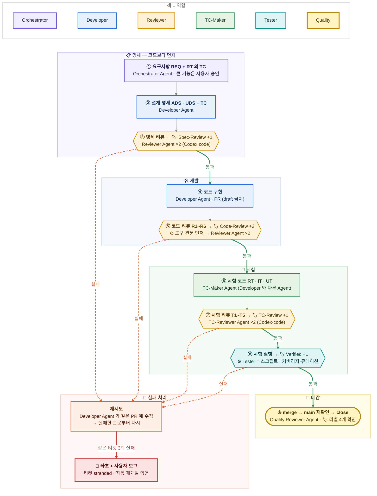

# 하니스 v2 — V 모델 검수 파이프라인

정본 설계안(원칙·역할·관문·검토 항목 R1~R6/T1~T5·도구 라이선스·비용 배치·도입 순서): Claude Docs 「하니스 v2 설계안 — V 모델 검수 파이프라인」 https://claude.ai/artifact/HJFnUXvcpyAaNa14DEsksC
이 파일은 흐름도 정본이다 — 설계가 바뀌면 같은 PR 에서 이 그림도 고친다. 역할은 세션·벤더 이름이 아니라 역할로 적고, 현재 배정은 괄호에 둔다.

